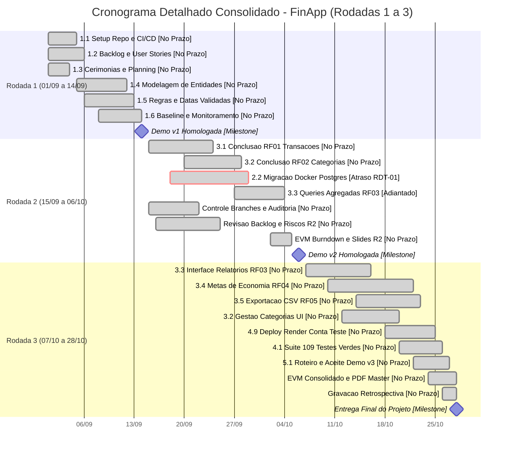

# Cronograma (Gantt) e Orçamento Detalhado — Consolidado Final (Rodadas 1 a 3)

**Responsável:** Filipe (Gerente de Projeto)  
**Projeto:** FinApp — GPMS / UFF  
**Baseline Orçamentário Global:** 153 Story Points · 612 horas · R$ 30.600,00 (Taxa: R$ 50,00/h)

---

## 1. Cronograma Detalhado (Gráfico de Gantt)

O Gráfico de Gantt a seguir detalha todas as atividades técnicas e gerenciais ao longo das três iterações do ciclo de vida do projeto, identificando explicitamente o status de entrega de cada pacote de trabalho (**Entregue no Prazo**, **Entregue com Atraso / Impacto RDT-01**, ou **Adiantado**).

### 1.1 Rastreabilidade e Diagnóstico de Prazos das Atividades

| ID EAP | Descrição da Atividade | Período Planejado | Período Realizado | Status de Prazo | Diagnóstico e Impacto Gerencial |
|:---:|---|:---:|:---:|:---:|---|
| **1.1–1.6** | Planejamento, Setup e Baseline R1 | 01/09 a 14/09 | 01/09 a 14/09 | **No Prazo** | Demo v1 entregue em 14/09, como planejado. |
| **3.1** | RF01 — Gerenciar Transações | 15/09 a 25/09 | 15/09 a 24/09 | **No Prazo** | Regras de data (ADR 001) e de valor implementadas com testes. |
| **3.2** | RF02 — Gerenciar Categorias | 20/09 a 30/09 | 20/09 a 28/09 | **No Prazo** | Categorias padrão e personalizadas prontas, com as regras do ADR 002. |
| **2.2** | Migração Docker e PostgreSQL (RDT-01) | 18/09 a 24/09 | 18/09 a 29/09 | **Com Atraso (+5 dias / +8h)** | Curva de aprendizado de containerização. Desvio absorvido pelo paralelismo dos desenvolvedores, sem atrasar o milestone da rodada. |
| **3.3** | Agregações SQL e Queries do RF03 | 01/10 a 06/10 | 27/09 a 04/10 | **Adiantado (-2 dias)** | Antecipação de escopo que conferiu folga para a Rodada 3. |
| **3.3–3.5** | RF03 UI, RF04 Metas e RF05 CSV | 07/10 a 24/10 | 07/10 a 23/10 | **No Prazo** | Com o Docker estável, RF03, RF04 e RF05 ficaram prontos em 17 dias. |
| **4.9** | Deploy Render e Conta de Teste | 18/10 a 26/10 | 18/10 a 25/10 | **No Prazo** | Publicação no Render com conta de teste (login por tela desde o PR #62). |
| **5.0** | Retrospectiva, PDF Consolidado e Fechamento | 22/10 a 28/10 | 22/10 a 28/10 | **No Prazo** | Retrospectiva gravada e documento consolidado gerado. |

---

## 2. Detalhamento do Orçamento do Projeto

### 2.1 Orçamento por Pacote de Trabalho da EAP

| ID EAP | Pacote de Trabalho | Esforço Planejado (h) | Custo Planejado (R$) | Esforço Real (h) | Custo Real (R$) | Variação (R$) | % Orçamento |
|:---:|---|:---:|:---:|:---:|:---:|:---:|:---:|
| **1.0** | Planejamento, Configuração e Governança | 50 h | R$ 2.500,00 | 48 h | R$ 2.400,00 | -R$ 100,00 | 7,8% |
| **2.0** | Arquitetura, Infraestrutura e Docker (RDT-01) | 80 h | R$ 4.000,00 | 88 h | R$ 4.400,00 | +R$ 400,00 | 14,3% |
| **3.1** | RF01 — Gerenciar Transações | 90 h | R$ 4.500,00 | 88 h | R$ 4.400,00 | -R$ 100,00 | 14,3% |
| **3.2** | RF02 — Gerenciar Categorias | 60 h | R$ 3.000,00 | 58 h | R$ 2.900,00 | -R$ 100,00 | 9,4% |
| **3.3** | RF03 — Visualizar Relatórios | 90 h | R$ 4.500,00 | 92 h | R$ 4.600,00 | +R$ 100,00 | 15,0% |
| **3.4** | RF04 — Gerenciar Metas de Economia | 85 h | R$ 4.250,00 | 86 h | R$ 4.300,00 | +R$ 50,00 | 14,0% |
| **3.5** | RF05 — Exportar Dados (CSV) | 45 h | R$ 2.250,00 | 44 h | R$ 2.200,00 | -R$ 50,00 | 7,2% |
| **4.0** | Qualidade, Testes Automatizados e Deploy | 72 h | R$ 3.600,00 | 71 h | R$ 3.550,00 | -R$ 50,00 | 11,5% |
| **5.0** | Encerramento, Retrospectiva e Documentação | 40 h | R$ 2.000,00 | 40 h | R$ 2.000,00 | R$ 0,00 | 6,5% |
| **Total** | **Projeto FinApp Consolidado** | **612 h** | **R$ 30.600,00** | **615 h** | **R$ 30.750,00** | **+R$ 150,00** | **100,0%** |

### 2.2 Orçamento por Membro da Equipe

| Integrante | Papel | Horas Previstas | Custo Previsto (R$) | Horas Reais | Custo Real (R$) | Variação (R$) | Variação (%) |
|---|---|:---:|:---:|:---:|:---:|:---:|:---:|
| **Filipe** | Gerente de Projeto (GP) & Dev | 88 h | R$ 4.400,00 | 87 h | R$ 4.350,00 | -R$ 50,00 | -1,1% |
| **Sara** | Product Owner (PO) | 80 h | R$ 4.000,00 | 79 h | R$ 3.950,00 | -R$ 50,00 | -1,3% |
| **Emanuel** | Scrum Master | 72 h | R$ 3.600,00 | 70 h | R$ 3.500,00 | -R$ 100,00 | -2,8% |
| **Arben** | Gerente de Configuração | 90 h | R$ 4.500,00 | 91 h | R$ 4.550,00 | +R$ 50,00 | +1,1% |
| **Enzo** | Desenvolvedor Infra/DB | 140 h | R$ 7.000,00 | 128 h | R$ 6.400,00 | -R$ 600,00 | -8,6% |
| **Giovana** | Desenvolvedora Backend | 142 h | R$ 7.100,00 | 160 h | R$ 8.000,00 | +R$ 900,00 | +12,7% |
| **Total** | **Equipe Completa** | **612 h** | **R$ 30.600,00** | **615 h** | **R$ 30.750,00** | **+R$ 150,00** | **+0,49%** |

*Custos de Infraestrutura Externa e Licenciamento:* **R$ 0,00** (uso estrito de infraestrutura open-source e planos gratuitos com PostgreSQL em nuvem no Render).

### 2.3 Resumo das Métricas de Término
*   **Orçamento no Término (BAC):** R$ 30.600,00 (612 h)
*   **Custo Real no Término (AC):** R$ 30.750,00 (615 h)
*   **Estimativa no Término (EAC = BAC / CPI):** R$ 30.750,00
*   **Variação no Término (VAC = BAC − EAC):** -R$ 150,00 (-0,49%)
*   **Estimativa para Terminar (ETC):** R$ 0,00 (Projeto concluído com 100% do escopo entregue).
