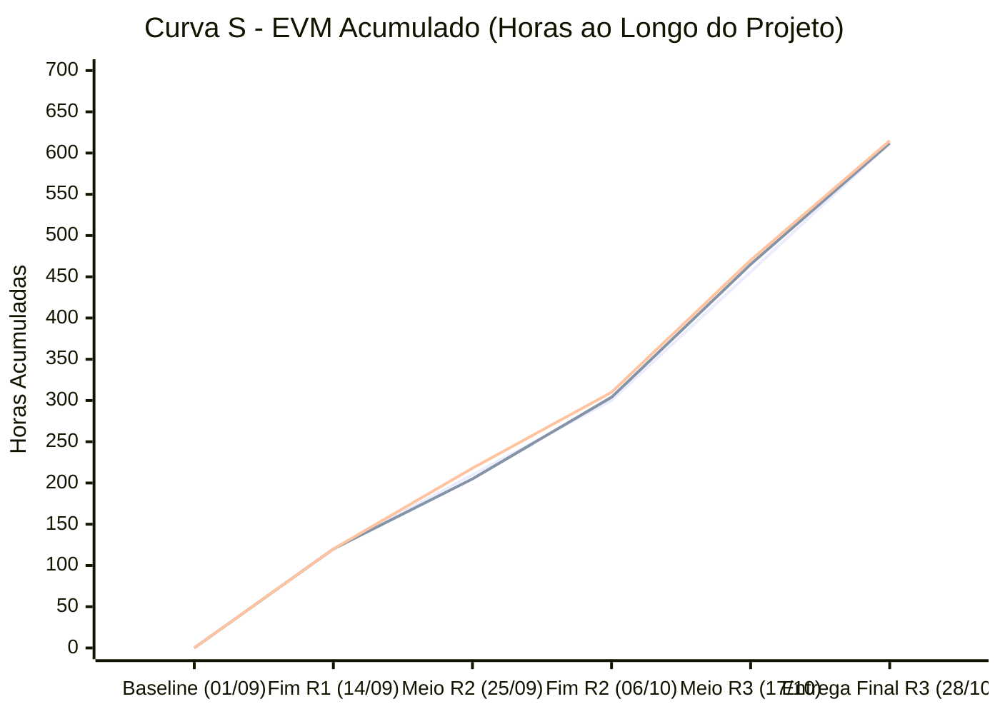
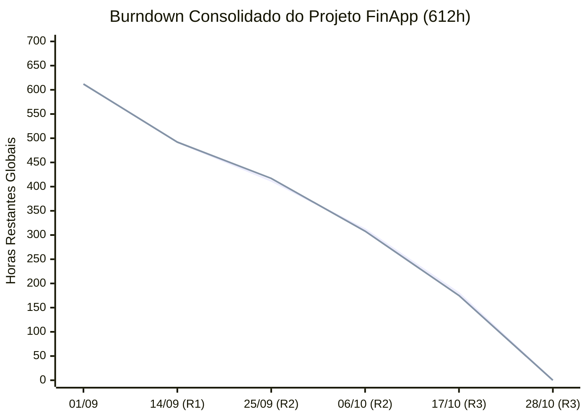

# Seção 7 — Monitoramento e Controle (Consolidado Final)

**Responsável:** Filipe (Gerente de Projeto)  
**Projeto:** FinApp (Finanças Pessoais) — GPMS / UFF  
**Baseline Global:** 153 Story Points · 612 horas · R$ 30.600,00 (Taxa: R$ 50,00/h)

---

## 1. Visão Consolidada de Monitoramento

O monitoramento do FinApp foi conduzido de forma contínua ao longo das três iterações do projeto, integrando **Earned Value Management (EVM)**, **Gráficos de Burndown** por sprint e acumulado, e a **Curva S** físico-financeira.

### 1.1 Tabela Consolidada de EVM (Iterações 1, 2 e 3)

| Indicador | Rodada 1 | Rodada 2 (Acumulada) | Rodada 3 (Final Consolidada) | Interpretação Gerencial |
|---|:---:|:---:|:---:|---|
| **Valor Planejado (PV)** | 120 h (R$ 6.000) | 300 h (R$ 15.000) | **612 h (R$ 30.600)** | Linha de base acumulada planejada (BAC = 612h). |
| **Valor Agregado (EV)** | 120 h (R$ 6.000) | 304 h (R$ 15.200) | **612 h (R$ 30.600)** | 100% do escopo físico concluído e homologado. |
| **Custo Real (AC)** | 120 h (R$ 6.000) | 310 h (R$ 15.500) | **615 h (R$ 30.750)** | Horas efetivamente trabalhadas pela equipe. |
| **SPI (EV / PV)** | **1,00** | **1,01** | **1,00** | Projeto rigorosamente no prazo estabelecido. |
| **CPI (EV / AC)** | **1,00** | **0,98** | **0,995** (~1,00) | Eficiência de custos normalizada após superação do Docker. |
| **Variação de Prazo (SV)** | 0 h | +4 h | **0 h** | Nenhum atraso no cronograma final de entrega. |
| **Variação de Custo (CV)** | 0 h | -6 h | **-3 h (-R$ 150)** | Desvio final irrelevante de apenas +0,49% sobre o orçamento. |
| **Estimativa no Término (EAC)** | R$ 30.600 | R$ 31.225 | **R$ 30.750** | Custo final estabilizado dentro da margem de tolerância. |
| **Estimativa para Terminar (ETC)** | R$ 24.600 | R$ 15.400 | **R$ 0,00** | Conclusão integral de todas as atividades do projeto. |

---

## 2. Curva S — Desempenho Físico e Financeiro Acumulado

---

## 3. Gráficos de Burndown (Visão por Rodada e Consolidado)

### 3.1 Rodada 1 (120h)
*   **Período:** 01/09 a 14/09/2026.
*   **Resultado:** 120h planejadas vs. 120h reais. Ritmo estável, absorção de pequenos ajustes de regras de negócio de datas e entrega da Demo v1 no prazo.

### 3.2 Rodada 2 (180h planejadas / 190h reais)
*   **Período:** 15/09 a 06/10/2026.
*   **Resultado:** Variação temporária de custo decorrente da decisão arquitetural RDT-01 (Docker/PostgreSQL e Flyway). O paralelismo entre desenvolvedores e GP permitiu adiantar tarefas do RF03 (Queries), fechando a sprint no prazo e homologando a Demo v2.

### 3.3 Rodada 3 (312h planejadas / 305h reais)
*   **Período:** 07/10 a 28/10/2026.
*   **Resultado:** Ambiente estável e ganhos de escala. Conclusão da interface de relatórios (RF03), metas de economia (RF04), exportação CSV (RF05), deploy no Render com conta de teste e aprovação de 109 testes automatizados.

### 3.4 Burndown Consolidado do Projeto (612h)

---

## 4. Análise de Desvios e Ações Corretivas

1.  **Migração para Docker/PostgreSQL (RDT-01):** Decisão estratégica que acarretou ~8h de esforço adicional na Rodada 2. A mitigação executada (scripts de seed, Docker Compose padronizado e isolamento de testes via Testcontainers) eliminou qualquer atrito técnico na Rodada 3, permitindo entregar o sistema na nuvem com extrema estabilidade.
2.  **Ajuste de Tipos Financeiros (NUMERIC vs Float):** Garantiu precisão absoluta em centavos em todas as operações (RNF05), verificado por testes de regressão automatizados.
3.  **Conclusão Operacional:** O projeto atinge o estado final com **SPI = 1,00**, **CPI = 0,995**, e 100% de conformidade com os critérios de aceite estabelecidos pela equipe e pela disciplina.
