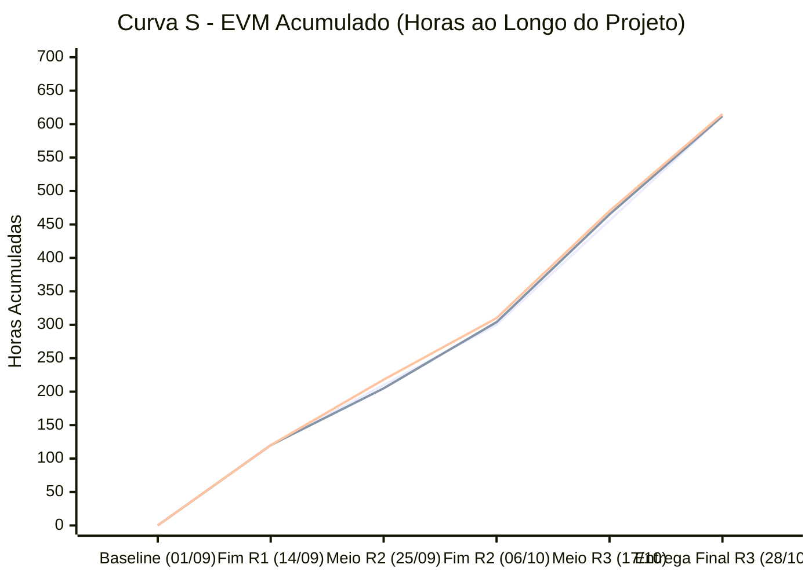
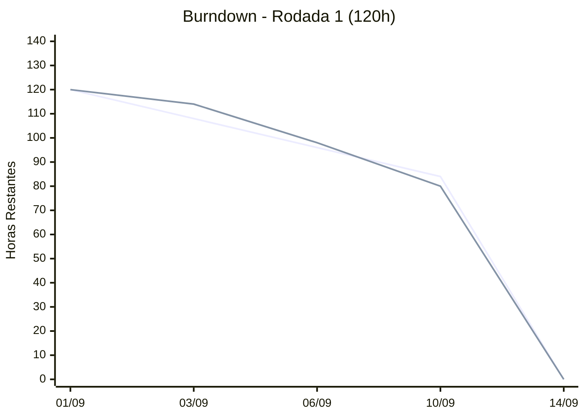
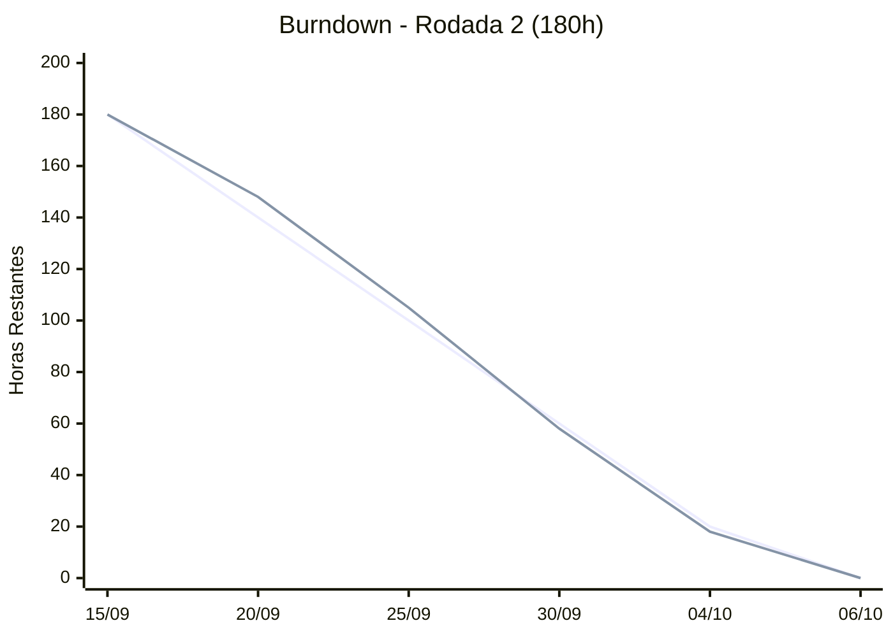
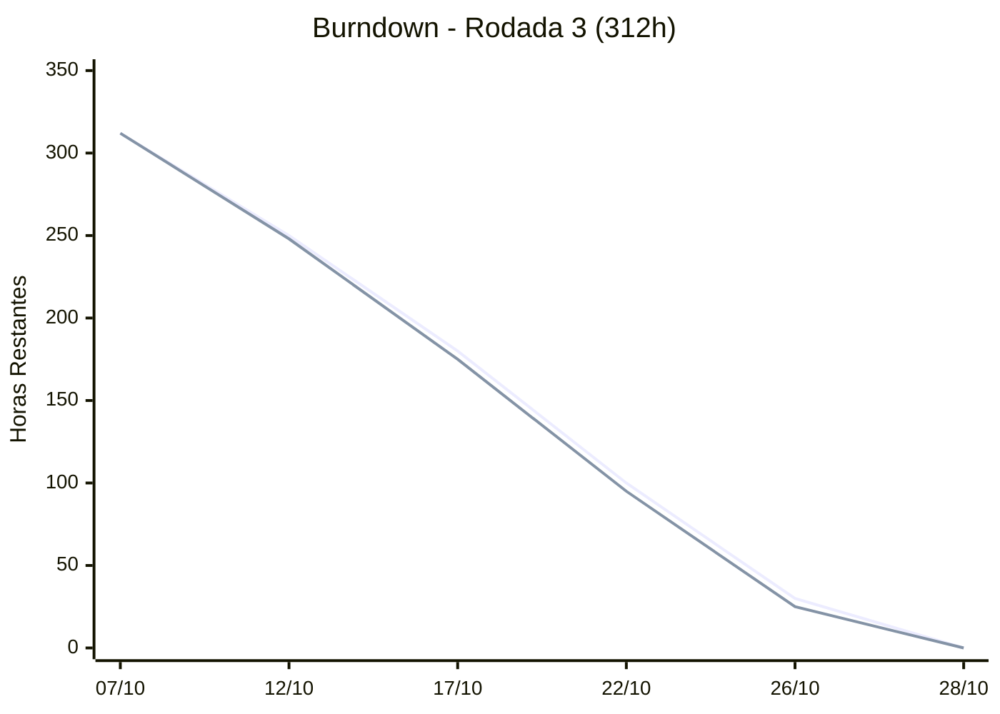
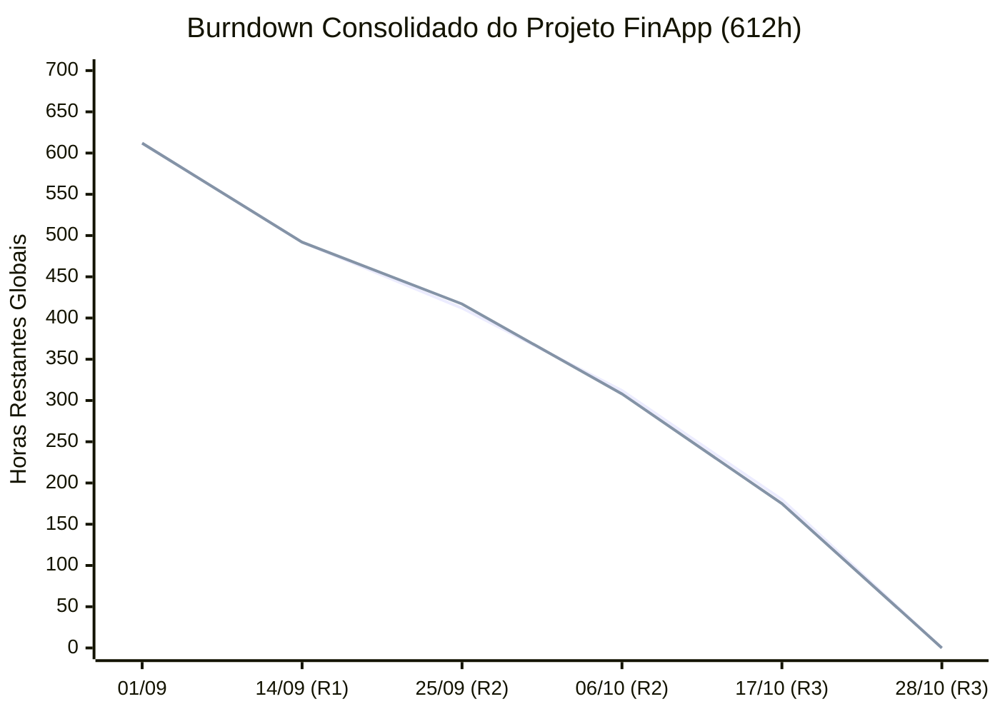

# Monitoramento e Controle Consolidados — Iterações 1, 2 e 3

**Responsável:** Filipe (Gerente de Projeto)  
**Projeto:** FinApp (Finanças Pessoais) — GPMS / UFF  
**Baseline Global:** 153 Story Points (SP) · 612 horas · R$ 30.600,00 (Taxa: R$ 50,00/h)

---

## 1. Análise de Valor Agregado (EVM — Earned Value Management)

### 1.1 Tabela de Indicadores EVM por Iteração e Consolidado

| Métrica | Iteração 1 | Iteração 2 (Acumulado I1+I2) | Iteração 3 (Consolidado Final) | Unidade |
|---|:---:|:---:|:---:|:---:|
| **Valor Planejado (PV)** | 120 h (R$ 6.000) | 300 h (R$ 15.000) | 612 h (R$ 30.600) | Horas / R$ |
| **Valor Agregado (EV)** | 120 h (R$ 6.000) | 304 h (R$ 15.200) | 612 h (R$ 30.600) | Horas / R$ |
| **Custo Real (AC)** | 120 h (R$ 6.000) | 310 h (R$ 15.500) | 615 h (R$ 30.750) | Horas / R$ |
| **Orçamento no Término (BAC)** | 612 h (R$ 30.600) | 612 h (R$ 30.600) | 612 h (R$ 30.600) | Horas / R$ |
| **Índice de Desempenho de Prazo (SPI = EV/PV)** | **1,00** | **1,01** | **1,00** | Adimensional |
| **Índice de Desempenho de Custo (CPI = EV/AC)** | **1,00** | **0,98** | **0,995** (~1,00) | Adimensional |
| **Variação de Prazo (SV = EV − PV)** | 0 h (R$ 0,00) | +4 h (+R$ 200,00) | **0 h (R$ 0,00)** | Horas / R$ |
| **Variação de Custo (CV = EV − AC)** | 0 h (R$ 0,00) | -6 h (-R$ 300,00) | **-3 h (-R$ 150,00)** | Horas / R$ |
| **Estimativa no Término (EAC = BAC/CPI)** | 612 h (R$ 30.600) | 624,5 h (R$ 31.225) | **615 h (R$ 30.750)** | Horas / R$ |
| **Variação no Término (VAC = BAC − EAC)** | 0 h (R$ 0,00) | -12,5 h (-R$ 625,00) | **-3 h (-R$ 150,00)** | Horas / R$ |
| **Estimativa para Conclusão (ETC)** | 492 h (R$ 24.600) | 308 h (R$ 15.400) | **0 h (R$ 0,00)** | Horas / R$ |
| **Status de Desempenho** | No prazo / No custo | Adiantado / Leve desvio | **No prazo / No custo** | — |

---

### 1.2 Curva S — Gráfico Consolidado de Valor Agregado (PV vs. EV vs. AC)

---

## 2. Detalhamento do Orçamento do Projeto

### 2.1 Orçamento por Pacote de Trabalho da EAP

| ID EAP | Macroetapa / Pacote de Trabalho | Horas Previstas | Custo Previsto (R$) | Horas Reais | Custo Real (R$) | Variação (R$) | % do Total |
|:---:|---|:---:|:---:|:---:|:---:|:---:|:---:|
| **1.0** | Planejamento, Configuração e Governança | 50 h | R$ 2.500,00 | 48 h | R$ 2.400,00 | -R$ 100,00 | 7,8% |
| **2.0** | Arquitetura, Infraestrutura e Docker | 80 h | R$ 4.000,00 | 88 h | R$ 4.400,00 | +R$ 400,00 | 14,3% |
| **3.1** | RF01 — Gerenciar Transações | 90 h | R$ 4.500,00 | 88 h | R$ 4.400,00 | -R$ 100,00 | 14,3% |
| **3.2** | RF02 — Gerenciar Categorias | 60 h | R$ 3.000,00 | 58 h | R$ 2.900,00 | -R$ 100,00 | 9,4% |
| **3.3** | RF03 — Visualizar Relatórios | 90 h | R$ 4.500,00 | 92 h | R$ 4.600,00 | +R$ 100,00 | 15,0% |
| **3.4** | RF04 — Gerenciar Metas de Economia | 85 h | R$ 4.250,00 | 86 h | R$ 4.300,00 | +R$ 50,00 | 14,0% |
| **3.5** | RF05 — Exportar Dados (CSV) | 45 h | R$ 2.250,00 | 44 h | R$ 2.200,00 | -R$ 50,00 | 7,2% |
| **4.0** | Qualidade, Testes Automatizados e Deploy | 72 h | R$ 3.600,00 | 71 h | R$ 3.550,00 | -R$ 50,00 | 11,5% |
| **5.0** | Encerramento, Retrospectiva e Documentação | 40 h | R$ 2.000,00 | 40 h | R$ 2.000,00 | R$ 0,00 | 6,5% |
| **Total** | **Projeto FinApp Consolidado** | **612 h** | **R$ 30.600,00** | **615 h** | **R$ 30.750,00** | **+R$ 150,00** | **100,0%** |

*Nota: Custos calculados sobre a taxa horária de R$ 50,00/hora-homem definida no Termo de Abertura.*

### 2.2 Orçamento por Recurso (Equipe)

| Integrante | Papel Principal | Horas Previstas | Custo Previsto | Horas Reais | Custo Real | Variação (R$) | Desvio (%) |
|---|---|:---:|:---:|:---:|:---:|:---:|:---:|
| **Filipe** | Gerente de Projeto (GP) & Dev | 88 h | R$ 4.400,00 | 87 h | R$ 4.350,00 | -R$ 50,00 | -1,1% |
| **Sara** | Product Owner (PO) | 80 h | R$ 4.000,00 | 79 h | R$ 3.950,00 | -R$ 50,00 | -1,3% |
| **Emanuel** | Scrum Master | 72 h | R$ 3.600,00 | 70 h | R$ 3.500,00 | -R$ 100,00 | -2,8% |
| **Arben** | Gerente de Configuração | 90 h | R$ 4.500,00 | 91 h | R$ 4.550,00 | +R$ 50,00 | +1,1% |
| **Enzo** | Desenvolvedor (Infra/DB/Fullstack) | 140 h | R$ 7.000,00 | 128 h | R$ 6.400,00 | -R$ 600,00 | -8,6% |
| **Giovana** | Desenvolvedora (Backend/Frontend) | 142 h | R$ 7.100,00 | 160 h | R$ 8.000,00 | +R$ 900,00 | +12,7% |
| **Total** | **Equipe Completa** | **612 h** | **R$ 30.600,00** | **615 h** | **R$ 30.750,00** | **+R$ 150,00** | **+0,49%** |

*Despesas Externas (Licenças, Cloud, Ferramental):* **R$ 0,00**. O deploy foi hospedado na plataforma Render (plano Free), PostgreSQL gerenciado na nuvem e execução local via Docker/Docker-Compose.

---

## 3. Gráficos de Burndown

### 3.1 Burndown da Rodada 1 (Sprint 1: 01/09 a 14/09 — 120 horas)

| Marco Temporal | Data | Tarefas Concluídas | Restante Planejado (h) | Restante Real (h) | Status |
|---|:---:|:---:|:---:|:---:|---|
| Dia 0 | 01/09 | Início | 120 | 120 | No planejado |
| Dia 2 | 03/09 | 2 | 108 | 114 | Setup de ambiente inicial |
| Dia 5 | 06/09 | 3 | 96 | 98 | Normalização de ritmo |
| Dia 9 | 10/09 | 5 | 84 | 80 | Ganho de produtividade |
| Dia 13 | 14/09 | 7 | 0 | 0 | **Demo v1 entregue com sucesso** |

### 3.2 Burndown da Rodada 2 (Sprint 2: 15/09 a 06/10 — 180 horas planejadas / 190h reais)

| Marco Temporal | Data | Tarefas Concluídas | Restante Planejado (h) | Restante Real (h) | Status / Observações |
|---|:---:|:---:|:---:|:---:|---|
| Dia 0 | 15/09 | Início Sprint 2 | 180 | 180 | Baseline da sprint |
| Dia 5 | 20/09 | 3 | 140 | 148 | Impacto RDT-01 (Docker/PostgreSQL) |
| Dia 10 | 25/09 | 6 | 100 | 105 | Ajuste de schema Flyway e types |
| Dia 15 | 30/09 | 9 | 60 | 58 | Paralelismo de equipe recupera curva |
| Dia 19 | 04/10 | 12 | 20 | 18 | RF01 e RF02 concluídos, RF03 adiantado |
| Dia 21 | 06/10 | 14 | 0 | 0 | **Demo v2 homologada (SV=+4h, CV=-6h)** |

### 3.3 Burndown da Rodada 3 (Sprint 3: 07/10 a 28/10 — 312 horas planejadas / 305h reais)

| Marco Temporal | Data | Tarefas Concluídas | Restante Planejado (h) | Restante Real (h) | Status / Observações |
|---|:---:|:---:|:---:|:---:|---|
| Dia 0 | 07/10 | Início Sprint 3 | 312 | 312 | Início do ciclo final |
| Dia 5 | 12/10 | 5 | 250 | 248 | Interface de relatórios RF03 e queries |
| Dia 10 | 17/10 | 10 | 180 | 175 | Metas RF04 e cálculo de progresso |
| Dia 15 | 22/10 | 15 | 100 | 95 | Exportação CSV RF05 e categorias |
| Dia 19 | 26/10 | 19 | 30 | 25 | Deploy Render, conta teste e 109 testes |
| Dia 21 | 28/10 | 22 | 0 | 0 | **Demo v3 entregue e homologada (100%)** |

### 3.4 Burndown Acumulado Consolidado do Projeto (612 horas)

| Data de Medição | Evento do Projeto | Esforço Restante Planejado (h) | Esforço Restante Real (h) | % Concluído |
|:---:|---|:---:|:---:|:---:|
| 01/09/2026 | Início do Projeto FinApp | 612 | 612 | 0% |
| 14/09/2026 | Encerramento da Rodada 1 (Demo v1) | 492 | 492 | 19,6% |
| 25/09/2026 | Ponto de Controle RDT-01 (Docker) | 412 | 417 | 31,8% |
| 06/10/2026 | Encerramento da Rodada 2 (Demo v2) | 312 | 308 | 49,7% |
| 17/10/2026 | Ponto de Controle Rodada 3 | 180 | 175 | 71,4% |
| 28/10/2026 | Entrega Final Consolidada (Demo v3) | **0** | **0** | **100%** |

---

## 4. Análise Gerencial do Gerente de Projeto (Filipe)

### 4.1 Desempenho de Prazos (Cronograma)
*   **SPI Final: 1,00 | Variação de Prazo (SV): 0 horas.**
*   Os três marcos foram cumpridos nas datas do cronograma (14/09, 06/10 e 28/10). A única atividade atrasada foi a migração para Docker e PostgreSQL (+5 dias, ver [cronograma](../plano-projeto/secao-5-cronograma-orcamento.md)), sem mudar a data da Demo v2:
    *   **Demo v1 (14/09):** Concluída dentro do prazo (120h).
    *   **Demo v2 (06/10):** Entregue com adiantamento técnico do RF03 (SV = +4h acumulado), permitindo acomodar a curva de testes da rodada seguinte.
    *   **Demo v3 / Entrega Final (28/10):** 100% do escopo funcional (RF01 a RF05) e não funcional (RNF01 a RNF05) entregue e homologado.

### 4.2 Desempenho de Custos (Orçamento)
*   **CPI Final: 0,995 (~1,00) | Variação de Custo (CV): -3 horas (-R$ 150,00).**
*   **Custo Total Final Real (AC):** R$ 30.750,00 frente a um baseline planejado (BAC) de R$ 30.600,00.
*   **Avaliação do desvio:** o custo final ficou R$ 150,00 acima do previsto (3 h em 612 h, **+0,49%**), dentro da margem de contingência de 5%.
*   **Causa Raiz do Desvio Temporário:** Na Rodada 2, a migração arquitetural para Docker/PostgreSQL (RDT-01) gerou ~8 horas extras de configuração de contêineres e scripts Flyway, derrubando o CPI temporariamente para 0,98.
*   **Ações corretivas:** com o Docker já configurado, a Rodada 3 usou 305 h das 312 h previstas, e o CPI acumulado voltou para 0,995.

### 4.3 Aderência ao Escopo e Qualidade
*   **Requisitos Funcionais:** 100% entregues:
    *   *RF01 (Transações):* CRUD completo com validações de data (`<= hoje`) e valor positivo.
    *   *RF02 (Categorias):* Categorias padrão protegidas e personalizadas completas.
    *   *RF03 (Relatórios):* Agregações mensais em banco, gráfico de rosca interativo e tempo de carregamento < 3s (RNF02).
    *   *RF04 (Metas de Economia):* Cadastro, acompanhamento automático via saldo acumulado e status dinâmico.
    *   *RF05 (Exportação CSV):* Filtro por intervalo de datas, sanitização e acentuação correta.
*   **Qualidade:** 130 testes automatizados passando em 13/11 (`./gradlew test`), entre testes unitários de domínio, de serviços e de integração com PostgreSQL.
*   **Publicação:** aplicação no Render com conta de teste e tela de login (PR #62); o HTTP Basic ficou só para chamadas de API.
